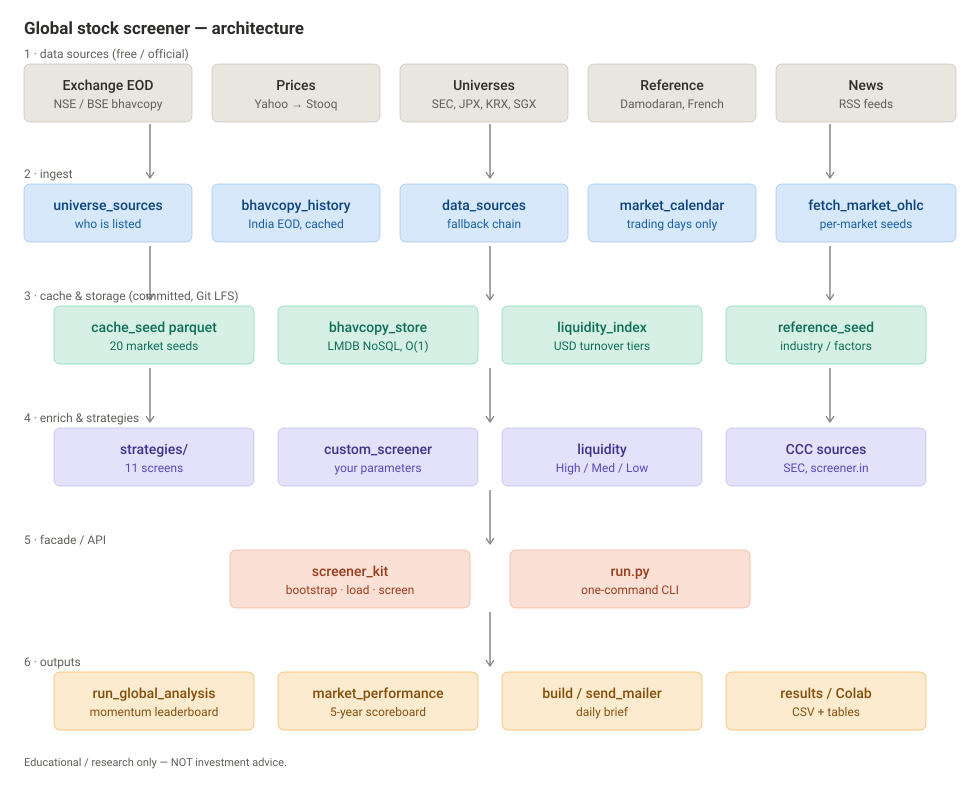

# 📈 Global Stock Screener

<!-- how-to-use-with-ai -->
> **New here?** See [How to use this repo with AI (Claude, Gemini, ChatGPT)](HOW_TO_USE_WITH_AI.md) — clone it, paste it into an AI tool, and ask in plain English.


[](https://colab.research.google.com/github/herrrickshaw/global-stock-screener/blob/main/colab_quickstart.ipynb)

A 20-market equity screener that **ships with ~1 year of cached price data** (≈40,000 symbols across the world's major exchanges), so you can clone and get results in minutes — no API keys, no LLM tokens.



> ⚠️ **Educational / research only. NOT investment advice.** Screener output is a mechanical filter, not a buy/sell signal. Past performance does not guarantee future returns. Consult a SEBI-registered (or your jurisdiction's) advisor.

---

## ▶️ Run in Google Colab (no setup)

```python
!pip install -q lmdb xlrd yfinance nsepython bseindia nse feedparser vaderSentiment investpy
!git lfs install && git clone --depth 1 https://github.com/herrrickshaw/global-stock-screener.git
%cd global-stock-screener && git lfs pull
!python run.py --strategy darvas --market IN          # → prints results + saves CSV
```

Or open **`colab_quickstart.ipynb`** and Runtime → Run all.

## ▶️ Run locally

```bash
git lfs install && git clone https://github.com/herrrickshaw/global-stock-screener.git
cd global-stock-screener && git lfs pull
pip install -r requirements.txt
python run.py                         # global momentum leaderboard
python run.py --strategy garp --market US --top 25
python run.py --brief                 # full Daily Market Brief → results/daily_brief.html
python run.py --list                  # all strategies & markets
```

`run.py` auto-bootstraps the cached data into a fast local store on first use, then
prints results and saves them to `results/`.

**Check readiness anytime:** `python preflight.py` verifies the initial conditions
(LFS data pulled, packages, serving views); `python preflight.py --ensure` establishes them.

---

## What you get

- **20 markets:** IN, US, JP, KR, CN, HK, TW, CA, AU, UK, DE, SA, BR, CH, ZA, SE, FI, DK, SG, Euronext
- **11 strategies:** `piotroski, coffee_can, magic_formula, bluest_blue_chips, debt_reduction, dividend_yield, golden_crossover, loss_to_profit, garp, darvas, cash_conversion_cycle`
- **Liquidity tiers** (High/Medium/Low) on every result + a fast liquidity pre-filter
- **Cash Conversion Cycle** for India (screener.in) and US (SEC EDGAR)
- **Custom screens** on your own parameters (returns, RSI, drawdown, volatility, CCC, …)
- **Global momentum leaderboard** + **20-market 5-year scoreboard**
- **Token-free daily mailer** (`send_mailer.py` + `daily_pipeline.sh`)

```python
import os; os.environ["BHAV_CACHE"] = "/content/cache"
import screener_kit as kit
kit.bootstrap()
kit.screen("darvas", "IN", top=15, min_turnover_usd=1_000_000)
kit.custom_screen({"ccc": ("<", 0), "above_200dma": ("==", True)}, "IN")
```

## Data sources (all free / official)

Exchange bhavcopy (NSE/BSE), SEC EDGAR (US fundamentals), JPX/KRX/SGX/Euronext/
Eastmoney (universes), Yahoo→Stooq (prices, with fallback), Damodaran & Fama-French
(reference), screener.in (India CCC), RSS + VADER (news sentiment — not an LLM).

## Tests

```bash
pip install pytest && pytest -q      # 20 tests, no network — pure logic
```
Covers data cleaning, all strategy modules, liquidity tiers, the custom screener,
and the LMDB store (round-trip on a temp cache).

## Documentation

| Doc | What's inside |
|-----|---------------|
| `FEATURES.md` | **capability catalog — every feature + how to run it** |
| `HOW_IT_WORKS.md` | step-by-step walk-through (bootstrap → screen → refresh → outputs) |
| `SCREENER_ACCESS.md` | how to provide screener.in creds (env vars) for India fundamentals |
| `DATA_SCHEMA_AND_ARCHITECTURE.md` | **full architecture map + data schemas (Mermaid diagrams)** |
| `TOGAF.md` / `governance.py` | **TOGAF EA alignment** (principles, ADM map) + executable governance check |
| `AGILE.md` / `backlog.py` | **SAFe operating model** + executable WSJF-prioritised backlog / PI planning |
| `ARCHITECTURE.md` | layered diagram, request→result flow, data schemas |
| `MEMORY_ARCHITECTURE.md` / `DATA_LINKAGE.md` / `AUTO_SCREENER.md` | tiered memory, linkage layer, ML/auto-screener |
| `DATA_AND_MODULES.md` | every data source + a one-line purpose for each module |
| `DATA_SOURCES.md` | **data sources: used capability + unused potential for future analysis** |
| `query.py` | **DuckDB SQL layer over the parquet seeds** (range/aggregate queries) |
| `partition_ltm.py` | **year-partition the LTM** (Hive market=/year=) for pruned queries at scale |
| `BLOOMBERG_SOURCES.md` | Bloomberg-terminal data categories → free/official equivalents |
| `EXCHANGE_COVERAGE.md` | the 20 markets validated vs Wikipedia's major exchanges |
| `colab_quickstart.ipynb` | run-top-to-bottom Colab notebook |
| `notebooks/` | **Colab checkpoint notebooks** for the data / screening / ML layers |
| `BRANCHES.md` | branch map (core on `main`, legacy on `archive/*`) |
| `DEPENDENCIES.md` | **code+data interdependency map** (blast radius for fixes) — `dep_map.py` |

## Repo layout

```
run.py                 one-command entry (auto-bootstraps, prints + saves results)
screener_kit.py        facade: bootstrap / load / get / update / screen / custom_screen
frames.py              shared OHLCV helpers (long↔dict, compact-parquet write) — DRY core
strategies/            11 strategy modules (base.py + one file each)
custom_screener.py     screen on your own metrics      liquidity.py   tiers + pre-filter
bhavcopy_history.py    India EOD ingest + cache         bhavcopy_store.py  LMDB store
data_sources.py        yahoo→stooq fallback            market_calendar.py trading days
universe_sources.py    per-market listed universe       fetch_market_ohlc.py  seeds
sec_fundamentals.py    US fundamentals (SEC EDGAR)      screener_in.py  India CCC
reference_data.py      Damodaran / Fama-French          ipo_monitor.py  new listings
run_global_analysis.py momentum leaderboard            market_performance.py 5y scoreboard
build_mailer.py        Daily Market Brief HTML          send_mailer.py  SMTP send (token-free)
daily_pipeline.sh      cron/launchd autonomous runner   *.plist  launchd schedule
cache_seed/  reference_seed/   committed data (Git LFS) · architecture.svg
```

See **`DATA_AND_MODULES.md`** for the full module guide and **`BLOOMBERG_SOURCES.md`**
for the Bloomberg-equivalent public-source map.
